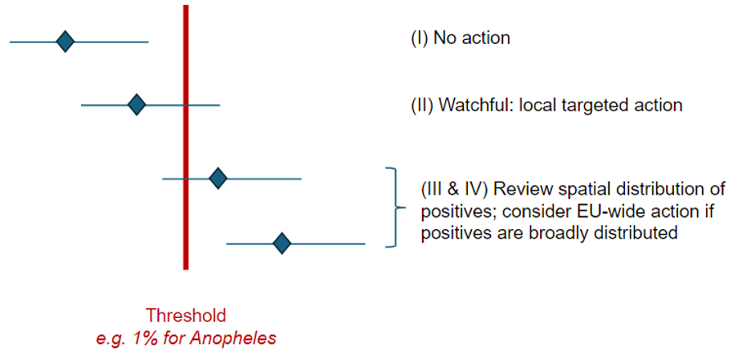

```{r setup, include=FALSE}
knitr::opts_chunk$set(echo = FALSE, message = FALSE, warning = FALSE)

# Application dependencies are installed and bundled during deployment.
required_packages <- c("shiny", "DT", "plotly")
missing_packages <- required_packages[
  !vapply(required_packages, requireNamespace, logical(1), quietly = TRUE)
]
if (length(missing_packages) > 0) {
  stop(
    "The deployment is missing required packages: ",
    paste(missing_packages, collapse = ", ")
  )
}
library(shiny)
library(plotly)
library(DT)

# Logit-normal clustered pool-count distribution functions.
source("R/logit-normal-pool-count-pmf.R")

```

# Purpose and scope

This document is intended to explain the assumptions behind sample-size calculations for MX pre- and post-validation surveillance.

The document is an **interactive R Markdown document**. It uses interactive tables and figures.

# Pre-validation surveillance

```{r PreVSFigure, echo=FALSE}

```

## What are we aiming for?
The above figure is from the LF MX PVS meeting in London in 2024. I think there was some broad agreement that this was the approach we were going to recommend for pre-validation surveillance efforts. Consequently the main action/decision trigger is when the *point estimate* of prevalence is *above* the appropriate threshold.

Since we want the decisions to act to be adequately powered, to my mind this means defining 'power' and 'sufficient sample size' as follows:

The 'power' of a survey design is the probability that the *point estimate* of the EU-wide prevalence that is calculated from a population representative random survey will be above the threshold.

The sample size needs to be large enough that if the true prevalence population is higher than the provisional threshold, then the power is at least 75\% (or some other defined value).

Now, if the true prevalence is only barely higher than the threshold, then even large sample sizes will have a roughly 50% power of getting a point estimate above the threshold, so we need to choose some *design prevalence* that is our lowest true prevalence at which we have the desired power.

The choice of this 'design prevalence' and 'power' are both non-trivial and not really a statistical problems. They should somehow relate to some notion of risk tolerance. If the design prevalence is too low or the power too high then the survey requirements are immense. If the design prevalence is too high or the power to small, then we risk EUs failing to detect resurgence for a long time.

## Statistical framework for power calculations
I've got some tables and figures for sample size below under various assumptions (which you can change as you like). But the basic maths is this.

For now, we ignore clustering and assume that each mosquito independently tests positive with probability $p$, with mosquitoes tested in pools of size $s$. Then the probability that a pool tests positive is $q = 1-(1-p)^s$. If there are $m$ pools across the EU (for a total of $n = sm$ mosquitoes tested), then the number of positive pools $X$ is distributed as a binomial random variable with size $m$ and probability $q$. The maximum likelihood estimate of the prevalence is simply

$$
\hat{p} = 1 - \left(1-\frac{X}{m}\right)^{\frac{1}{s}}.
$$

Consequently, the probability that $\hat{p}$ is above some threshold value $p_t$ satisfies

$$
\begin{align*}
P(\hat{p}>p_t)
& = P\left(X>m\left[1-(1-p_t)^s\right]\right)\\
& = \sum_{x=\lfloor m[1-(1-p_t)^s]\rfloor+1}^{m}\binom{m}{x}\left[1-(1-p)^s\right]^x(1-p)^{s(m-x)}.
\end{align*}
$$


## Power of a single survey

<details>
<summary>Details</summary>

<p>Choose a threshold, a design prevalence, and a pool size to explore the probability that the maximum-likelihood prevalence estimate exceeds the selected threshold. The design prevalence defaults to twice the selected threshold, and can be edited independently.</p>

<p>The available thresholds are <em>Aedes</em> (0.1%), <em>Anopheles</em> (1%), <em>Culex</em> (0.25%), and <em>Mansonia</em> (0.5%).</p>

<p>The calculation assumes independent mosquito infection status and perfect pool classification. It uses the exact binomial probability, with the number of pools as the binomial sample size. The plotted total sample sizes are multiples of the selected pool size.</p>

</details>

```{r responsive-controls-css, echo=FALSE}
tags$style(HTML(paste0(
  ".controls-row { display: flex; flex-wrap: wrap; align-items: flex-start; gap: 12px 18px; } ",
  ".controls-row > .form-group, .controls-row > .shiny-input-container, .controls-row > .shiny-html-output { flex: 1 1 220px; min-width: 220px; margin-bottom: 8px; } ",
  ".controls-row .shiny-input-container { width: 100% !important; max-width: 100%; }"
)))
```

```{r prevalidation-controls}
div(
  class = "controls-row",
  selectInput(
    "threshold_species",
    "Threshold",
    choices = c(
      "Aedes (0.1%)" = "0.001",
      "Anopheles (1%)" = "0.01",
      "Culex (0.25%)" = "0.0025",
      "Mansonia (0.5%)" = "0.005"
    ),
    selected = "0.001"
  ),
  uiOutput("design_prevalence_ui"),
  numericInput(
    "pool_size",
    "Pool size (mosquitoes per pool)",
    value = 25,
    min = 1,
    max = 1000,
    step = 1
  ),
  numericInput(
    "max_pools",
    "Maximum number of pools shown in the figure",
    value = 400,
    min = 1,
    max = 10000,
    step = 50
  )
)
```

```{r prevalidation-function}
# Exact probability that the prevalence MLE exceeds the threshold.
prob_estimate_above_threshold <- function(p, p_t, s, m) {
  stopifnot(
    length(p) == 1L, is.finite(p), p >= 0, p < 1,
    length(p_t) == 1L, is.finite(p_t), p_t >= 0, p_t < 1,
    length(s) == 1L, is.finite(s), s >= 1, s == as.integer(s),
    length(m) == 1L, is.finite(m), m >= 1, m == as.integer(m)
  )

  q <- -expm1(s * log1p(-p))
  q_t <- -expm1(s * log1p(-p_t))
  pbinom(floor(m * q_t), size = m, prob = q, lower.tail = FALSE)
}
```

```{r prevalidation-design-input}
output$design_prevalence_ui <- renderUI({
  p_t <- as.numeric(input$threshold_species)
  numericInput(
    "design_prevalence_percent",
    "Design prevalence (%)",
    value = 200 * p_t,
    min = 0,
    max = 99,
    step = max(10 * p_t, 0.001)
  )
})
```

```{r prevalidation-probability-plot}
renderPlotly({
  p_t <- as.numeric(input$threshold_species)
  p <- input$design_prevalence_percent / 100
  s <- input$pool_size
  max_pools <- input$max_pools

  validate(
    need(is.finite(p) && p >= 0 && p < 1,
         "Design prevalence must be at least 0 and less than 1."),
    need(is.finite(s) && s >= 1 && s == as.integer(s),
         "Pool size must be a positive integer."),
    need(is.finite(max_pools) && max_pools >= 1,
         "Maximum number of pools must be at least 1.")
  )

  m_values <- seq_len(as.integer(max_pools))
  probabilities <- vapply(
    m_values,
    function(m) prob_estimate_above_threshold(p, p_t, as.integer(s), m),
    numeric(1)
  )
  plotly::plot_ly(
    x = m_values * as.integer(s),
    y = probabilities,
    type = "scatter",
    mode = "lines",
    hovertemplate = paste0(
      "Total mosquitoes: %{x:,}<br>",
      "Pools: %{customdata}<br>",
      "Probability: %{y:.1%}<extra></extra>"
    ),
    customdata = m_values
  ) |>
    plotly::layout(
      xaxis = list(title = "Total sample size (n = s × m)"),
      yaxis = list(
        title = "P(prevalence estimate > threshold)",
        tickformat = ".0%",
        range = c(0, 1)
      ),
      margin = list(b = 70, l = 75)
    )
})
```


*The saw-tooth shape occurs because the number of positive pools is discrete: as the number of pools increases, the minimum number of positive pools needed to exceed the threshold sometimes jumps up by one. At each jump the probability that the minimum number of positive pools are found drops substantially, then rises again more slowly as more pools are added until the minimum number of positive pools increases by one again, repeating the cycle.*

```{r prevalidation-current-result}
renderUI({
  p_t <- as.numeric(input$threshold_species)
  p <- input$design_prevalence_percent / 100
  s <- input$pool_size
  max_pools <- input$max_pools
  validate(
    need(is.finite(p) && p >= 0 && p < 1,
         "Design prevalence must be at least 0 and less than 1."),
    need(is.finite(s) && s >= 1 && s == as.integer(s),
         "Pool size must be a positive integer."),
    need(is.finite(max_pools) && max_pools >= 1,
         "Maximum number of pools must be at least 1.")
  )
  m <- as.integer(max_pools)
  probability <- prob_estimate_above_threshold(p, p_t, as.integer(s), m)
  tags$div(
    class = "well",
    tags$h4(sprintf("Probability at n = %s: %.1f%%",
                    format(m * as.integer(s), big.mark = ","), 100 * probability)),
    tags$p(sprintf(
      "Threshold = %.3g%%; design prevalence = %.3g%%; pool size = %d; pools = %s.",
      100 * p_t, 100 * p, as.integer(s), format(m, big.mark = ",")
    ))
  )
})
```


## Power with trapping-location-level heterogeneity

<details>
<summary>Details</summary>

<p>This figure extends the single-survey power calculation to allow prevalence to vary between trapping locations. Trapping-location-specific prevalence follows a logit-normal distribution: logit(p<sub>j</sub>) = μ + σZ<sub>j</sub>, where Z<sub>j</sub> is standard normal. The design prevalence is the arithmetic mean prevalence across trapping locations, E[p_j]. The input is the intraclass correlation coefficient (ICC) between infection statuses of two mosquitoes sampled from the same trapping location. For each selected design prevalence and ICC, μ and σ are obtained from the specified mean and variance of trapping-location prevalence using PoolPoweR’s link-normal helper.</p>

<p>The ICC is calculated directly as Corr(Y<sub>1</sub>, Y<sub>2</sub>) = Var(p<sub>j</sub>)/[p̄(1 − p̄)], where p̄ = E[p<sub>j</sub>] is the design prevalence. This is the marginal Pearson correlation between two binary infection indicators from the same trapping location, assuming conditional independence given trapping-location prevalence; it is not a latent-scale correlation or an approximation based on σ. The corresponding trapping-location prevalence variance is therefore ICC × p̄ × (1 − p̄). The logit-normal parameters are obtained using PoolPoweR’s <code>mu_sigma_linknorm()</code> helper with <code>qlogis</code> and <code>plogis</code>.</p>

<p>The number of pools sampled at each trapping location is held fixed. The calculation increases the number of independent trapping locations, and hence the total number of pools and mosquitoes. Power is the probability that the pooled-prevalence MLE exceeds the selected threshold. The total positive-pool count distribution is calculated using the FFT-based method above. ICC = 1 is handled as the limiting case in which each trapping location's prevalence is either zero or one.</p>

</details>

```{r clustered-power-controls}
div(
  class = "controls-row",
  selectInput(
    "clustered_threshold_species",
    "Threshold",
    choices = c(
      "Aedes (0.1%)" = "0.001",
      "Anopheles (1%)" = "0.01",
      "Culex (0.25%)" = "0.0025",
      "Mansonia (0.5%)" = "0.005"
    ),
    selected = "0.001"
  ),
  uiOutput("clustered_design_prevalence_ui"),
  numericInput(
    "clustered_icc",
    "Within-trapping-location ICC",
    value = 0.1,
    min = 0,
    max = 1,
    step = 0.01
  ),
  numericInput(
    "clustered_pool_size",
    "Pool size (mosquitoes per pool)",
    value = 25,
    min = 1,
    max = 1000,
    step = 1
  ),
  numericInput(
    "clustered_pools_per_trap_location",
    "Pools per trapping location",
    value = 2,
    min = 1,
    max = 1000,
    step = 1
  ),
  numericInput(
    "clustered_max_trap_locations",
    "Maximum number of trapping locations shown",
    value = 100,
    min = 1,
    max = 1000,
    step = 10
  )
)
```

```{r clustered-design-prevalence-input}
output$clustered_design_prevalence_ui <- renderUI({
  p_t <- as.numeric(input$clustered_threshold_species)
  numericInput(
    "clustered_design_prevalence_percent",
    "Design prevalence (%)",
    value = 200 * p_t,
    min = 0,
    max = 99,
    step = max(10 * p_t, 0.001)
  )
})
```

```{r clustered-power-plot}
# Convert the marginal mean prevalence and binary within-trapping-location ICC to
# the parameters of a logit-normal trapping-location prevalence distribution.
logit_normal_parameters_from_icc <- function(design_prevalence, icc) {
  stopifnot(
    length(design_prevalence) == 1L, is.finite(design_prevalence),
    design_prevalence > 0, design_prevalence < 1,
    length(icc) == 1L, is.finite(icc), icc >= 0, icc < 1
  )

  # With zero variance the logit-normal distribution is degenerate.
  if (icc == 0) {
    return(c(mu = qlogis(design_prevalence), sigma = 0))
  }

  trapping_location_prevalence_variance <-
    icc * design_prevalence * (1 - design_prevalence)

  parameters <- logit_normal_parameters_from_moments(
    mean = design_prevalence,
    variance = trapping_location_prevalence_variance
  )
  setNames(as.numeric(parameters), c("mu", "sigma"))
}

renderPlotly({
  p_t <- as.numeric(input$clustered_threshold_species)
  design_prevalence <- input$clustered_design_prevalence_percent / 100
  icc <- input$clustered_icc
  s <- input$clustered_pool_size
  v <- input$clustered_pools_per_trap_location
  max_trap_locations <- input$clustered_max_trap_locations

  validate(
    need(length(design_prevalence) == 1L && is.finite(design_prevalence) &&
           design_prevalence > 0 && design_prevalence < 1,
         "Design prevalence must be greater than 0% and less than 100%."),
    need(length(icc) == 1L && is.finite(icc) && icc >= 0 && icc <= 1,
         "ICC must be between 0 and 1."),
    need(is.finite(s) && s >= 1 && s == as.integer(s),
         "Pool size must be a positive integer."),
    need(is.finite(v) && v >= 1 && v == as.integer(v),
         "Pools per trapping location must be a positive integer."),
    need(is.finite(max_trap_locations) && max_trap_locations >= 1 && max_trap_locations == as.integer(max_trap_locations),
         "Maximum number of trapping locations must be a positive integer.")
  )

  s <- as.integer(s)
  v <- as.integer(v)
  max_trap_locations <- as.integer(max_trap_locations)
  trapping_locations <- seq_len(max_trap_locations)
  total_pools <- trapping_locations * v
  q_t <- -expm1(s * log1p(-p_t))

  if (icc < 1) {
    parameters <- logit_normal_parameters_from_icc(design_prevalence, icc)
    mu <- unname(parameters[["mu"]])
    sigma <- unname(parameters[["sigma"]])
    power <- vapply(trapping_locations, function(w) {
      pmf <- logit_normal_pool_count_pmf(
        w=w, v=v, s=s, mu=mu, sigma=sigma, n_quad=120L
      )
      cutoff <- floor((w * v) * q_t) + 1L
      first_index <- cutoff + 1L
      if (first_index > length(pmf)) return(0)
      sum(pmf[first_index:length(pmf)])
    }, numeric(1))
    parameter_label <- paste0(
      "Implied μ = ", formatC(mu, digits=3, format="f"),
      "; σ = ", formatC(sigma, digits=3, format="f")
    )
  } else {
    # Limiting case as sigma tends to infinity: trapping-location prevalence is 1
    # with probability equal to the design prevalence, and 0 otherwise.
    power <- vapply(trapping_locations, function(w) {
      positive_trap_locations <- 0:w
      positive_pools <- v * positive_trap_locations
      cutoff <- floor((w * v) * q_t) + 1L
      sum(dbinom(positive_trap_locations, size=w, prob=design_prevalence)[positive_pools >= cutoff])
    }, numeric(1))
    parameter_label <- "ICC = 1 (limiting case: sigma tends to infinity)"
  }

  plot_data <- data.frame(
    trapping_locations=trapping_locations, total_pools=total_pools,
    total_mosquitoes=total_pools*s, power=power
  )
  plot_data$hover_text <- paste0(
    "Trapping locations: ", format(plot_data$trapping_locations, big.mark=",", scientific=FALSE), "<br>",
    "Pools: ", format(plot_data$total_pools, big.mark=",", scientific=FALSE), "<br>",
    "Total mosquitoes: ", format(plot_data$total_mosquitoes, big.mark=",", scientific=FALSE), "<br>",
    "Power: ", sprintf("%.1f%%", 100*plot_data$power)
  )
  plotly::plot_ly(
    data=plot_data, x=~total_mosquitoes, y=~power,
    type="scatter", mode="lines", text=~hover_text, hoverinfo="text"
  ) |>
    plotly::layout(
      xaxis=list(title="Total sample size (mosquitoes)"),
      yaxis=list(title="P(prevalence estimate > threshold)", tickformat=".0%", range=c(0,1)),
      margin=list(b=70,l=75),
      annotations=list(list(
        x=1,y=1,xref="paper",yref="paper",text=parameter_label,
        showarrow=FALSE,xanchor="right",yanchor="bottom"
      ))
    )
})
```

## Minimum sample size for a desired power

<details>
<summary>Details</summary>

<p>Choose the required probability that the prevalence estimate exceeds the threshold. The calculator searches over integer numbers of pools and returns the <strong>largest crossing</strong> of the power threshold: i.e. the smallest sample size such that the required power is satisfied for it and all larger sample sizes. This avoids choosing a smaller target sample size that might meet the power minimum but comes just before a saw-tooth dip, i.e. if the achieved sample size were to slightly exceed the target, the power would be less than what is required </p>

<p>The search is limited by the maximum number of pools below. If the target is not met within that limit, the plotted value is unavailable; this does not necessarily mean that no sample size could ever meet the target.</p>

</details>

```{r sample-size-calculator-controls}
div(
  class = "controls-row",
  selectInput(
    "calculator_threshold_species",
    "Threshold",
    choices = c(
      "Aedes (0.1%)" = "0.001",
      "Anopheles (1%)" = "0.01",
      "Culex (0.25%)" = "0.0025",
      "Mansonia (0.5%)" = "0.005"
    ),
    selected = "0.001"
  ),
  uiOutput("calculator_design_prevalence_ui"),
  numericInput(
    "required_power",
    "Required power (%)",
    min = 1,
    max = 99,
    value = 75,
    step = 1
  ),
  numericInput(
    "calculator_pool_size",
    "Pool size (mosquitoes per pool)",
    value = 25,
    min = 1,
    max = 1000,
    step = 1
  ),
  numericInput(
    "calculator_max_pools",
    "Maximum number of pools searched",
    value = 200,
    min = 100,
    max = 10000,
    step = 10
  ),
  radioButtons(
    "sample_size_y_scale",
    "Sample-size axis",
    choices = c("Linear scale" = "linear", "Log scale" = "log"),
    selected = "linear",
    inline = TRUE
  )
)
```

```{r sample-size-calculator-design-input}
output$calculator_design_prevalence_ui <- renderUI({
  p_t <- as.numeric(input$calculator_threshold_species)
  numericInput(
    "calculator_design_prevalence_percent",
    "Design prevalence (%)",
    value = 200 * p_t,
    min = 0,
    max = 99,
    step = max(10 * p_t, 0.001)
  )
})
```

```{r sample-size-calculator-function}
# Return the minimum pool count after the final below-target dip in the
# searched range. This selects the larger crossing when power is non-monotone.
minimum_pools_for_power <- function(p, p_t, s, required_power, max_pools) {
  stopifnot(
    length(p) == 1L, is.finite(p), p >= 0, p < 1,
    length(p_t) == 1L, is.finite(p_t), p_t >= 0, p_t < 1,
    length(s) == 1L, is.finite(s), s >= 1, s == as.integer(s),
    length(required_power) == 1L, is.finite(required_power),
    required_power > 0, required_power < 1,
    length(max_pools) == 1L, is.finite(max_pools),
    max_pools >= 1, max_pools == as.integer(max_pools)
  )

  m <- seq_len(as.integer(max_pools))
  q <- -expm1(as.integer(s) * log1p(-p))
  q_t <- -expm1(as.integer(s) * log1p(-p_t))
  power <- pbinom(floor(m * q_t), size = m, prob = q,
                  lower.tail = FALSE)
  below <- which(power < required_power)

  if (length(below) == 0L) return(1L)
  last_below <- max(below)
  if (last_below >= length(m)) return(NA_integer_)
  as.integer(last_below + 1L)
}
```

```{r sample-size-calculator-plot}
renderPlotly({
  p_t <- as.numeric(input$calculator_threshold_species)
  s <- input$calculator_pool_size
  required_power <- input$required_power / 100
  max_pools <- input$calculator_max_pools

  validate(
    need(is.finite(s) && s >= 1 && s == as.integer(s),
         "Pool size must be a positive integer."),
    need(is.finite(required_power) && required_power > 0 && required_power < 1,
         "Required power must be between 0% and 100%."),
    need(is.finite(max_pools) && max_pools >= 100 &&
           max_pools == as.integer(max_pools),
         "Maximum number of pools must be an integer of at least 100.")
  )

  design_prevalences <- seq(p_t, 3 * p_t, by = 0.0001)

  # Use a rounded tick interval targeting around 5-10 x-axis labels.
  # The axis is displayed in percent, so calculate the interval on that scale.
  prevalence_range_percent <- 100 * (3 * p_t - p_t)
  raw_tick <- prevalence_range_percent / 8
  tick_magnitude <- 10^floor(log10(raw_tick))
  tick_fraction <- raw_tick / tick_magnitude
  nice_fraction <- if (tick_fraction <= 1) {
    1
  } else if (tick_fraction <= 2) {
    2
  } else if (tick_fraction <= 5) {
    5
  } else {
    10
  }
  prevalence_tick <- nice_fraction * tick_magnitude

  pool_counts <- vapply(
    design_prevalences,
    function(p) minimum_pools_for_power(
      p, p_t, as.integer(s), required_power, as.integer(max_pools)
    ),
    integer(1)
  )
  sample_sizes <- pool_counts * as.integer(s)
  plot_data <- data.frame(
    design_prevalence = 100 * design_prevalences,
    sample_size = sample_sizes,
    pools = pool_counts
  )

  p <- plotly::plot_ly(
    data = plot_data,
    x = ~design_prevalence,
    y = ~sample_size,
    type = "scatter",
    mode = "lines+markers",
    connectgaps = FALSE,
    customdata = ~pools,
    hovertemplate = paste0(
      "Design prevalence: %{x:.4g}%<br>",
      "Total mosquitoes: %{y:,}<br>",
      "Pools: %{customdata}<extra></extra>"
    )
  )

  # The exact threshold is the theoretical boundary. Near it, required
  # sample sizes may exceed the finite search limit.
  shapes <- list()
  annotations <- list()
  if (required_power > 0.5) {
    shapes <- append(shapes, list(list(
      type = "line", xref = "x", yref = "paper",
      x0 = 100 * p_t, x1 = 100 * p_t,
      y0 = 0, y1 = 1,
      line = list(color = "rgba(200, 50, 50, 0.8)", dash = "dash", width = 2)
    )))
    annotations <- append(annotations, list(list(
      x = 100 * p_t, y = -0.18, xref = "x", yref = "paper",
      text = "Threshold",
      showarrow = FALSE, xanchor = "center", yanchor = "top",
      font = list(size = 10)
    )))
  }

  p |>
    plotly::layout(
      xaxis = list(
        title = "Design prevalence (%)",
        tickmode = "linear",
        tick0 = 0,
        dtick = prevalence_tick
      ),
      yaxis = if (input$sample_size_y_scale == "log") {
        list(title = "Required total sample size (mosquitoes)", type = "log")
      } else {
        list(
          title = "Required total sample size (mosquitoes)",
          type = "linear",
          rangemode = "tozero"
        )
      },
      shapes = shapes,
      annotations = annotations,
      margin = list(b = 70, l = 85)
    )
})
```

```{r sample-size-calculator-result}
renderUI({
  p_t <- as.numeric(input$calculator_threshold_species)
  s <- input$calculator_pool_size
  required_power <- input$required_power / 100
  max_pools <- input$calculator_max_pools
  validate(
    need(is.finite(s) && s >= 1 && s == as.integer(s),
         "Pool size must be a positive integer."),
    need(is.finite(required_power) && required_power > 0 && required_power < 1,
         "Required power must be between 0% and 100%."),
    need(is.finite(max_pools) && max_pools >= 1 &&
           max_pools == as.integer(max_pools),
         "Maximum number of pools must be a positive integer.")
  )

  # The design-prevalence input is created dynamically and may not yet
  # exist during the initial Shiny render.
  req(input$calculator_design_prevalence_percent)
  p <- input$calculator_design_prevalence_percent / 100
  validate(need(length(p) == 1L && is.finite(p) && p >= 0 && p < 1,
                "Design prevalence must be at least 0 and less than 1."))
  m <- minimum_pools_for_power(
    p, p_t, as.integer(s), required_power, as.integer(max_pools)
  )

  if (is.na(m)) {
    tags$div(
      class = "well",
      tags$h4("Required power not reached within the search limit"),
      tags$p(sprintf(
        "No stable sample size was found up to %s pools (%s mosquitoes). This may require a larger search limit.",
        format(as.integer(max_pools), big.mark = ","),
        format(as.integer(max_pools) * as.integer(s), big.mark = ",")
      ))
    )
  } else {
    probability <- prob_estimate_above_threshold(
      p, p_t, as.integer(s), m
    )
    tags$div(
      class = "well",
      tags$h4(sprintf(
        "Required sample size: %s mosquitoes (%s pools)",
        format(m * as.integer(s), big.mark = ","),
        format(m, big.mark = ",")
      )),
      tags$p(sprintf(
        "Threshold = %.3g%%; design prevalence = %.3g%%; target power = %.1f%%; achieved power = %.1f%%.",
        100 * p_t, 100 * p, 100 * required_power, 100 * probability
      ))
    )
  }
})
```

*The periodic jumps in the required sample size as the design prevalence approaches the threshold is because of the saw-tooth shape in the power curve (see figure in previous section). We are defining the 'required sample size' as the smallest sample size such that all larger sample sizes satisfy the power requirement. Because there can only be an integer number of positive pools, the required number of positives for the estimate to exceed the threshold periodically increases by one, at which point the number of total pools needed to achieve this with the desired power jumps substantially.*

## Recommended sample sizes per EU for single surveys

Below are the recommended sample size per EU under the framework. I have copied the table format in the draft chapter, however you can change the assumptions to see how this affects sample size.

As you can see, for the default assumptions, the required sample sizes are quite modest! However the choice of design prevalence is really influential here, and simply choosing a multiplier of 2 seems arbitrary

The design prevalence is set to twice the provisional threshold by default but can be increased or decreased ('Multiplier for design prevalence').

As none of the calculations here account for clustering I've introduced a design effect of 2. This can be increased or decreased ('Design effect'). 

```{r recommended-sample-sizes-controls}
div(
  class = "controls-row",
  numericInput(
    "recommended_required_power",
    "Required power (%)",
    value = 75,
    min = 1,
    max = 99,
    step = 1
  ),
  numericInput(
    "recommended_design_prevalence_multiplier",
    "Multiplier for design prevalence",
    value = 2,
    min = 1,
    step = 0.1
  ),
  numericInput(
    "recommended_design_effect",
    "Design effect",
    value = 2,
    min = 1,
    step = 0.1
  ),
  numericInput(
    "recommended_pool_size",
    "Pool size (mosquitoes per pool)",
    value = 25,
    min = 1,
    max = 1000,
    step = 1
  )
)
```

```{r recommended-sample-sizes-table}
renderDataTable({
  required_power <- input$recommended_required_power / 100
  design_prevalence_multiplier <- input$recommended_design_prevalence_multiplier
  design_effect <- input$recommended_design_effect
  pool_size <- input$recommended_pool_size

  validate(
    need(is.finite(required_power) && required_power > 0 && required_power < 1,
         "Required power must be between 0% and 100%."),
    need(is.finite(design_prevalence_multiplier) &&
           design_prevalence_multiplier >= 1,
         "The design-prevalence multiplier must be at least 1."),
    need(is.finite(design_effect) && design_effect >= 1,
         "The design effect must be at least 1."),
    need(is.finite(pool_size) && pool_size >= 1 &&
           pool_size == as.integer(pool_size),
         "Pool size must be a positive integer.")
  )

  genera <- data.frame(
    genus = c("Aedes", "Culex", "Mansonia", "Anopheles"),
    threshold = c(0.001, 0.0025, 0.005, 0.01)
  )
  genera$design_prevalence <- genera$threshold *
    design_prevalence_multiplier

  validate(
    need(all(genera$design_prevalence < 1),
         "The resulting design prevalences must be less than 100%.")
  )

  # Search up to 100,000 pools for each genus. Values not reached within
  # this limit are reported as unavailable rather than extrapolated.
  max_pools <- 100000L
  genera$minimum_pools <- vapply(
    seq_len(nrow(genera)),
    function(i) minimum_pools_for_power(
      p = genera$design_prevalence[i],
      p_t = genera$threshold[i],
      s = as.integer(pool_size),
      required_power = required_power,
      max_pools = max_pools
    ),
    integer(1)
  )

  genera$minimum_sample_size <- genera$minimum_pools * as.integer(pool_size)
  genera$design_effect_sample_size <- ifelse(
    is.na(genera$minimum_sample_size),
    NA_real_,
    ceiling(genera$minimum_sample_size * design_effect)
  )

  display_value <- function(x) {
    ifelse(
      is.na(x),
      "Not reached",
      format(x, big.mark = ",", scientific = FALSE, trim = TRUE)
    )
  }

  table_data <- data.frame(
    Genus = genera$genus,
    Threshold = sprintf("%.3g%%", 100 * genera$threshold),
    `Design prevalence` = sprintf("%.3g%%", 100 * genera$design_prevalence),
    `Minimum sample size (ignoring clustering)` =
      display_value(genera$minimum_sample_size),
    `Minimum sample size (Design effect = D)` =
      display_value(genera$design_effect_sample_size),
    check.names = FALSE
  )
  names(table_data)[5] <- paste0(
    "Minimum sample size (Design effect = ",
    format(design_effect, trim = TRUE, scientific = FALSE),
    ")"
  )

  datatable(
    table_data,
    rownames = FALSE,
    options = list(
      pageLength = 4,
      lengthChange = FALSE,
      searching = FALSE,
      paging = FALSE,
      info = FALSE,
      ordering = FALSE,
      scrollX = TRUE,
      columnDefs = list(list(className = "dt-right", targets = 1:4))
    )
  )
})
```

## What about false discovery?

The sample sizes recommended above do not have any consideration for false discovery --- i.e. the probability that the MLE will be above the threshold (leading to potential EU-wide action) when the true prevalence is in fact below the threshold value. How big a problem is this? The figure below shows the probabilities for the recommended sample sizes in the table above (Note: changing the assumptions for the table above also updates the figure below).

The probability of false discovery is highest when the true prevalence is close to (but below) the threshold. This is, to my mind, not such a bad thing since if the prevalence is still close to the threshold when the Pre-VS survey is taking place (which is probably a number of years after the last TAS), then this indicates transmission is not decreasing substantially and some action may be required anyway.

When the true prevalence is about half the threshold, the false discovery probability is roughly 10-15\% (though this depends on choice of assumptions above). **Is this acceptable?** Again, this is an *operational decision*, not a statistical one. If avoiding false discovery is of similar importance to ensuring true discoveries, then perhaps instead of comparing the MLE to the threshold we need to consider comparing the lower confidence bound (say 75%) to the threshold. But this is not what was decided in the London meeting.

```{r false-discovery-controls}
div(
  class = "controls-row",
  selectInput(
    "false_discovery_genus",
    "Genus",
    choices = c("Aedes", "Culex", "Mansonia", "Anopheles"),
    selected = "Aedes",
    selectize = FALSE
  )
)
```

```{r false-discovery-plot}
renderPlotly({
  required_power <- input$recommended_required_power / 100
  design_prevalence_multiplier <- input$recommended_design_prevalence_multiplier
  pool_size <- input$recommended_pool_size
  genus <- input$false_discovery_genus

  validate(
    need(is.finite(required_power) && required_power > 0 && required_power < 1,
         "Required power must be between 0% and 100%."),
    need(is.finite(design_prevalence_multiplier) &&
           design_prevalence_multiplier >= 1,
         "The design-prevalence multiplier must be at least 1."),
    need(is.finite(pool_size) && pool_size >= 1 &&
           pool_size == as.integer(pool_size),
         "Pool size must be a positive integer."),
    need(genus %in% c("Aedes", "Culex", "Mansonia", "Anopheles"),
         "Please select a genus.")
  )

  thresholds <- c(Aedes = 0.001, Culex = 0.0025,
                  Mansonia = 0.005, Anopheles = 0.01)
  p_t <- unname(thresholds[genus])
  design_prevalence <- p_t * design_prevalence_multiplier
  validate(need(design_prevalence < 1,
                "The design prevalence must be less than 100%."))

  m <- minimum_pools_for_power(
    p = design_prevalence,
    p_t = p_t,
    s = as.integer(pool_size),
    required_power = required_power,
    max_pools = 100000L
  )
  validate(need(!is.na(m),
                "The recommended sample size was not reached within 100,000 pools."))

  # Increment of 0.01 percentage points on the prevalence scale.
  true_prevalence <- seq(0, design_prevalence, by = 0.0001)
  if (tail(true_prevalence, 1) < design_prevalence) {
    true_prevalence <- c(true_prevalence, design_prevalence)
  }
  probability <- vapply(
    true_prevalence,
    function(p) prob_estimate_above_threshold(p, p_t,
                                               as.integer(pool_size), m),
    numeric(1)
  )
  plot_data <- data.frame(
    prevalence = 100 * true_prevalence,
    probability = probability
  )
  left <- plot_data[plot_data$prevalence <= 100 * p_t, ]
  right <- plot_data[plot_data$prevalence >= 100 * p_t, ]

  plotly::plot_ly() |>
    plotly::add_trace(
      data = left, x = ~prevalence, y = ~probability,
      type = "scatter", mode = "lines", fill = "tozeroy",
      fillcolor = "rgba(220, 70, 70, 0.22)",
      line = list(color = "firebrick"),
      name = "True prevalence below threshold",
      hovertemplate = paste0(
        "True prevalence: %{x:.3f}%<br>",
        "P(MLE > threshold): %{y:.1%}<extra></extra>"
      )
    ) |>
    plotly::add_trace(
      data = right, x = ~prevalence, y = ~probability,
      type = "scatter", mode = "lines", fill = "tozeroy",
      fillcolor = "rgba(70, 170, 100, 0.22)",
      line = list(color = "seagreen"),
      name = "True prevalence at or above threshold",
      hovertemplate = paste0(
        "True prevalence: %{x:.3f}%<br>",
        "P(MLE > threshold): %{y:.1%}<extra></extra>"
      )
    ) |>
    plotly::layout(
      xaxis = list(title = "True prevalence (%)"),
      yaxis = list(
        title = "Probability that the MLE exceeds the threshold",
        tickformat = ".0%",
        range = c(0, 1)
      ),
      shapes = list(list(
        type = "line", xref = "x", yref = "paper",
        x0 = 100 * p_t, x1 = 100 * p_t,
        y0 = 0, y1 = 1,
        line = list(color = "black", dash = "dash", width = 2)
      )),
      annotations = list(list(
        x = 100 * p_t, y = 1, xref = "x", yref = "paper",
        text = "Threshold", showarrow = FALSE,
        xanchor = "left", yanchor = "bottom"
      )),
      legend = list(
        orientation = "h",
        x = 0,
        y = 1.18,
        xanchor = "left",
        yanchor = "bottom"
      ),
      margin = list(t = 90, b = 65, l = 85)
    )
})
```

```{r false-discovery-assumptions}
renderUI({
  required_power <- input$recommended_required_power / 100
  design_prevalence_multiplier <- input$recommended_design_prevalence_multiplier
  pool_size <- input$recommended_pool_size
  genus <- input$false_discovery_genus

  validate(
    need(is.finite(required_power) && required_power > 0 && required_power < 1,
         "Required power must be between 0% and 100%."),
    need(is.finite(design_prevalence_multiplier) &&
           design_prevalence_multiplier >= 1,
         "The design-prevalence multiplier must be at least 1."),
    need(is.finite(pool_size) && pool_size >= 1 &&
           pool_size == as.integer(pool_size),
         "Pool size must be a positive integer."),
    need(genus %in% c("Aedes", "Culex", "Mansonia", "Anopheles"),
         "Please select a genus.")
  )

  thresholds <- c(Aedes = 0.001, Culex = 0.0025,
                  Mansonia = 0.005, Anopheles = 0.01)
  p_t <- unname(thresholds[genus])
  design_prevalence <- p_t * design_prevalence_multiplier
  m <- minimum_pools_for_power(
    p = design_prevalence,
    p_t = p_t,
    s = as.integer(pool_size),
    required_power = required_power,
    max_pools = 100000L
  )
  validate(need(!is.na(m),
                "The recommended sample size was not reached within 100,000 pools."))

  positive_pools_required <- floor(
    m * (-expm1(as.integer(pool_size) * log1p(-p_t)))
  ) + 1L

  tags$p(sprintf(
    paste0(
      "The figure assumes a total sample size of %s mosquitoes, ",
      "tested in pools of %s mosquitoes. The MLE exceeds the threshold ",
      "when at least %s pools test positive."
    ),
    format(m * as.integer(pool_size), big.mark = ","),
    format(as.integer(pool_size), big.mark = ","),
    format(positive_pools_required, big.mark = ",")
  ))
})
```

## Sampling over time

The above assumes that we are powering to estimate the prevalence and compare this to the threshold at a single timepoint. But in some pre-validation surveillance settings, surveillance may have to be repeated for a long time. How does this effect our considerations? There's a lot to explore here:

- how far apart to space the surveys?
- how should each survey be powered?
- should the design and timing of be influenced by the previous surveys (e.g. if prevalence is found to be very low in the previous survey, can you wait for longer?)
- what if prevalence is increasing over time?
- should repeat survey visit the same HHs and/or sites within the EU, or a new set of randomly selected sites?

I am not going to discuss all these things but below I outline another way of thinking about sequential cross-sectional survey that helps to turn the very abstract 'what should the power and design prevalence be' into something more concrete in terms of 'how long before we detect the disease'?

The basic idea is that the smaller the sample size, the less likely one survey is to find that the prevalence is above the threshold, and the more surveys (and years) it will take to detect that the disease has gone over the threshold. If the disease is spreading quickly in this time this can mean a substantial setback in elimination progress, while if it is spreading slowly taking some time to detect resurgence is not so much of a problem.

So I propose a 'time to detect resurgence' framework for designing a series of cross-sectional Pre-VS surveys. We can think of this in terms of

- the number of surveys before  detecting resurgence
- the number of years before detecting resurgence
- the true prevalence when resurgence is detected.


### Mathematical framework for sampling over time

I will assume that when the final TAS is passed is 'year 0'. Since we are interested in being able to detect cases where resurgence is occurring I will assume that in the EUs which are facing challenges that need to be detected, prevalence starts at the threshold value and slowly grows over time, e.g. doubling in prevalence every five years. The prevalence at year $y$, $p(y)$, then follows the form $p(y) = p_t e^{\lambda y}$ where $p(0) = p_t$ is the prevalence when the final TAS is passed, and $\lambda$ is a constant describing the growth rate.

As a simplifying assumption, as before we ignore clustering. Further we assume that sequential surveys samples are statistically independent of one another. In practice for this assumption to be met, the selected sites and HHs would have to be randomly selected for each survey.

Then for a particular schedule of surveys (e.g. yearly, every five years) and sample size (number of mosquito) we can calculate:

- the number of surveys, $N$, before detecting resurgence;
- the number of years, $Y$, before detecting resurgence;
- the true prevalence, $p(Y)$, when resurgence is detected.


### Time to detecting resurgence (first survey where prevalence is over threshold)


```{r}
surveys_to_detection <- function(
    g,
    s,
    m,
    p0,
    pt,
    lambda,
    Jmax = 100
) {
  # Validate inputs
  stopifnot(
    length(g) == 1L, is.finite(g), g > 0,
    length(s) == 1L, is.finite(s), s >= 1, s == floor(s),
    length(m) == 1L, is.finite(m), m >= 1, m == floor(m),
    length(p0) == 1L, is.finite(p0), p0 >= 0, p0 <= 1,
    length(pt) == 1L, is.finite(pt), pt > 0, pt < 1,
    length(lambda) == 1L, is.finite(lambda),
    length(Jmax) == 1L, is.finite(Jmax),
    Jmax >= 1, Jmax == floor(Jmax)
  )

  Jmax <- as.integer(Jmax)

  # Minimum number of positive pools required for estimated prevalence > pt
  pi_threshold <- -expm1(s * log1p(-pt))
  cutoff <- floor(m * pi_threshold) + 1L

  # Survey times and true prevalence
  j <- seq_len(Jmax)
  time <- j * g
  prevalence <- pmin(1, p0 * exp(lambda * time))

  # Probability that a pool tests positive at each survey
  pool_positive <- -expm1(s * log1p(-prevalence))

  # Probability of detecting resurgence in each survey
  q <- pbinom(
    cutoff - 1L,
    size = m,
    prob = pool_positive,
    lower.tail = FALSE
  )

  # Probability of first detection at each survey
  probability_N <- numeric(Jmax)
  survival <- 1

  for (i in seq_len(Jmax)) {
    probability_N[i] <- survival * q[i]
    survival <- survival * (1 - q[i])
  }

  list(
    distribution = data.frame(
      survey = j,
      time = time,
      true_prevalence = prevalence,
      detection_probability = q,
      probability_N_equals_j = probability_N
    ),
    probability_not_detected_by_Jmax = survival,
    pool_positive_cutoff = cutoff,
    total_individuals_per_survey = s * m
  )
}
```


```{r sampling-over-time-controls}
div(
  class = "controls-row",
  numericInput(
    "time_survey_interval",
    "Interval between surveys (years)",
    value = 2,
    min = 1,
    max = 100,
    step = 1
  ),
  numericInput(
    "time_pool_size",
    "Mosquitoes per pool",
    value = 25,
    min = 1,
    max = 1000,
    step = 1
  ),
  numericInput(
    "time_n_pools",
    "Number of pools per survey",
    value = 100,
    min = 1,
    max = 10000,
    step = 10
  ),
  selectInput(
    "time_threshold_genus",
    "Threshold",
    choices = c(
      "Aedes (0.1%)" = "0.001",
      "Anopheles (1%)" = "0.01",
      "Culex (0.25%)" = "0.0025",
      "Mansonia (0.5%)" = "0.005"
    ),
    selected = "0.001",
    selectize = FALSE
  ),
  numericInput(
    "time_start_percent",
    "Starting prevalence (%)",
    value = 0.1,
    min = 0,
    max = 100,
    step = 0.1
  ),
  numericInput(
    "time_doubling_time",
    "Prevalence doubling time (years)",
    value = 6,
    min = 0.01,
    max = 1000,
    step = 0.5
  ),
  numericInput(
    "time_max_surveys",
    "Maximum number of surveys",
    value = 10,
    min = 1,
    max = 1000,
    step = 1
  )
)
```

```{r sampling-over-time-results}
observeEvent(input$time_threshold_genus, {
  updateNumericInput(
    session,
    "time_start_percent",
    value = 100 * as.numeric(input$time_threshold_genus)
  )
}, ignoreInit = TRUE)

sampling_over_time_result <- reactive({
  req(
    input$time_survey_interval,
    input$time_pool_size,
    input$time_n_pools,
    input$time_threshold_genus,
    input$time_start_percent,
    input$time_doubling_time,
    input$time_max_surveys
  )

  validate(
    need(input$time_survey_interval > 0, "Survey interval must be positive."),
    need(input$time_pool_size >= 1, "Pool size must be at least 1."),
    need(input$time_n_pools >= 1, "Number of pools must be at least 1."),
    need(input$time_start_percent >= 0 &&
           input$time_start_percent <= 100,
         "Starting prevalence must be between 0% and 100%."),
    need(input$time_doubling_time > 0, "Doubling time must be positive."),
    need(input$time_max_surveys >= 1, "Maximum number of surveys must be at least 1.")
  )

  surveys_to_detection(
    g = input$time_survey_interval,
    s = as.integer(input$time_pool_size),
    m = as.integer(input$time_n_pools),
    p0 = input$time_start_percent / 100,
    pt = as.numeric(input$time_threshold_genus),
    lambda = log(2) / input$time_doubling_time,
    Jmax = as.integer(input$time_max_surveys)
  )
})

renderUI({
  result <- sampling_over_time_result()
  tags$p(
    sprintf(
      paste0(
        "Total mosquitoes per survey: %s. ",
        "Minimum positive pools needed to exceed the threshold: %s. ",
        "Probability of remaining undetected after %s surveys: %.1f%%."
      ),
      format(result$total_individuals_per_survey, big.mark = ","),
      result$pool_positive_cutoff,
      nrow(result$distribution),
      100 * result$probability_not_detected_by_Jmax
    )
  )
})
```

```{r sampling-over-time-table}
renderDataTable({
  result <- sampling_over_time_result()
  dat <- result$distribution

  datatable(
    data.frame(
      `Survey` = dat$survey,
      `Time (years)` = sprintf("%.0f", dat$time),
      `True prevalence` = sprintf("%.2f%%", 100 * dat$true_prevalence),
      `Probability detected (this survey)` = sprintf("%.1f%%", 100 * dat$detection_probability),
      `Cumulative probability detected (this and previous surveys)` = sprintf(
        "%.1f%%",
        100 * cumsum(dat$probability_N_equals_j)
      ),
      check.names = FALSE
    ),
    rownames = FALSE,
    options = list(
      pageLength = 10,
      lengthChange = FALSE,
      searching = FALSE,
      scrollX = TRUE,
      columnDefs = list(list(className = "dt-right", targets = "_all"))
    ),
    caption = "Distribution of the number of surveys until resurgence is detected"
  )
})
```
